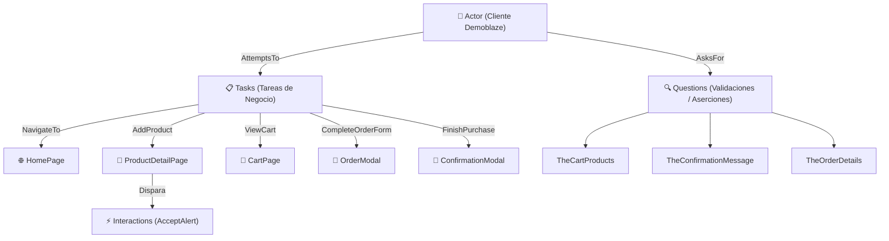

# 🛒 Automatización E2E - Flujo de Compra en Demoblaze

> **Prueba Técnica QA Automation** | Banco Pichincha - TCS (Tata Consultancy Services)  
> **Autor:** Ronald Berrones  
> **Framework:** Serenity BDD 4.1.20 + Cucumber 7 + Screenplay Pattern + Java 17 + Maven  
> **Página Bajo Prueba:** [Demoblaze](https://www.demoblaze.com/)

---

## 📋 Resumen del Ejercicio

El presente proyecto implementa la prueba funcional automatizada de **extremo a extremo (E2E)** requerida para el flujo completo de compra en la tienda virtual **Demoblaze**, cumpliendo con los estándares de ingeniería de pruebas, arquitectura orientada al negocio (**BDD**) y patrones de diseño recomendados para la industria financiera.

### Flujo Cubierto
1. **Navegación**: Carga de la aplicación web y catálogo de productos.
2. **Selección y Adición de Productos**: Selección de 2 dispositivos móviles ("Samsung galaxy s6" y "Nokia lumia 1520"), agregándolos al carrito y gestionando sincronizadamente las alertas nativas de JavaScript (`window.alert`).
3. **Visualización del Carrito**: Verificación de la presencia de ambos artículos y consistencia del carrito.
4. **Formulario de Compra**: Diligenciamiento de la información del comprador en el modal Bootstrap (`#orderModal`).
5. **Finalización de la Compra**: Confirmación del pedido y validación de las aserciones de negocio sobre el componente SweetAlert (`Thank you for your purchase!`, ID generado, monto y tarjeta).

---

## 🏛️ Arquitectura del Framework (Screenplay Pattern)

Se implementó el patrón **Screenplay**, el cual supera las limitaciones del clásico *Page Object Model (POM)* al aplicar rigurosamente los principios **SOLID**, garantizando alta cohesión, bajo acoplamiento y máxima reusabilidad de componentes.



### Capas del Proyecto

| Capa | Paquete | Propósito |
| :--- | :--- | :--- |
| **Model** | `com.demoblaze.automation.model` | Entidades y DTOs (`CustomerInfo`, `OrderDetails`, `ProductOrder`). |
| **User Interfaces** | `com.demoblaze.automation.userinterfaces` | Mapeo de selectores y elementos mediante `Target` de Serenity. |
| **Tasks** | `com.demoblaze.automation.tasks` | Tareas de alto nivel del usuario (`NavigateTo`, `AddProduct`, `ViewCart`, `CompleteOrderForm`, `FinishPurchase`, `CloseConfirmation`). |
| **Interactions** | `com.demoblaze.automation.interactions` | Acciones atómicas de bajo nivel con el navegador (`AcceptAlert`). |
| **Questions** | `com.demoblaze.automation.questions` | Consultas para verificar el estado de la UI y realizar aserciones (`TheCartProducts`, `TheConfirmationMessage`, `TheOrderDetails`). |
| **Step Definitions** | `com.demoblaze.automation.stepdefinitions` | Enlace entre los pasos Gherkin y los actores (`PurchaseStepDefinitions`, `Hook`). |
| **Runners** | `com.demoblaze.automation.runners` | Ejecutor de JUnit con `CucumberWithSerenity.class`. |
| **Util** | `com.demoblaze.automation.util` | Constantes globales y lectores de datos (`JsonReader`, `CsvReader`). |

---

## 📊 Estrategia Data-Driven (Gherkin, JSON y CSV)

El proyecto cuenta con escenarios optimizados con soporte para múltiples fuentes de datos de prueba:

1. **Variables y Scenario Outline nativo en Gherkin**: Parametrización declarativa mediante tablas de `Ejemplos:`.
2. **Consumo Dinámico desde JSON**: Carga de casos de prueba estructurados desde `src/test/resources/data/datos_compra.json` utilizando Jackson ObjectMapper.
3. **Consumo Dinámico desde CSV**: Carga de registros planos desde `src/test/resources/data/datos_compra.csv` utilizando OpenCSV.

---

## ⚙️ Requisitos y Configuración

- **Java JDK**: 17 o superior.
- **Apache Maven**: 3.8 o superior.
- **Google Chrome**: Instalado (Selenium Manager gestiona el ChromeDriver de forma transparente).

---

## 🚀 Comandos de Ejecución

Situarse en la carpeta del ejercicio:
```bash
cd reto_tecnico_qa_tcs/Ejercicio_E2E
```

| Objetivo | Comando |
| :--- | :--- |
| **Ejecución Completa** | `mvn clean verify` |
| **Escenario Smoke (Flujo Completo)** | `mvn verify "-Dcucumber.filter.tags=@Smoke"` |
| **Esquema del Escenario (Data-Driven)** | `mvn verify "-Dcucumber.filter.tags=@EsquemaEscenario"` |
| **Consumo desde JSON** | `mvn verify "-Dcucumber.filter.tags=@ConsumoJson"` |
| **Consumo desde CSV** | `mvn verify "-Dcucumber.filter.tags=@ConsumoCsv"` |
| **Ejecución Headless** | `mvn verify "-Dheadless.mode=true"` |
| **Generar Reporte Serenity** | `mvn serenity:aggregate` |

---

## 📑 Reportes Generados

### 1. Serenity BDD Living Documentation (Reporte HTML Principal)
Ubicación: `target/site/serenity/index.html`  
- Historial paso a paso con capturas de pantalla automáticas.
- Tiempos de respuesta de cada interacción.
- Auditoría completa de tareas y preguntas ejecutadas por el actor.

### 2. Reportes Estándar de Cucumber
- **HTML**: `target/cucumber-reports/cucumber.html`
- **JSON**: `target/cucumber-reports/cucumber.json`

